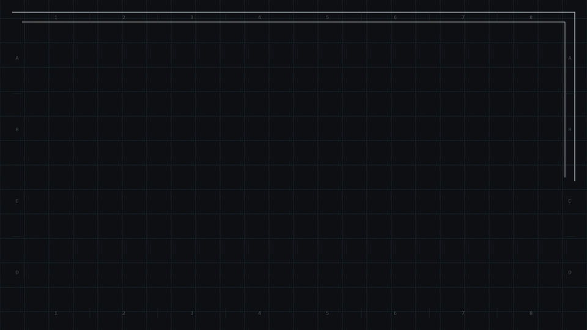
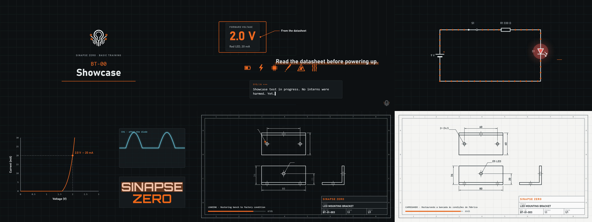
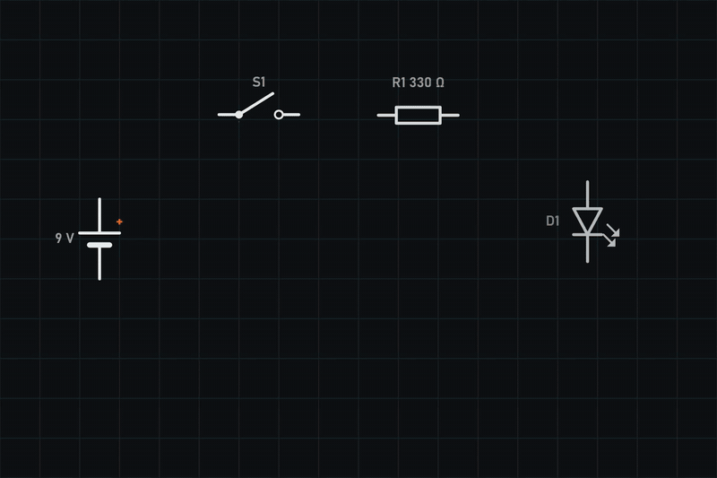

# sinapse-zero-studio

**A code-first studio for narrated technical explainer videos**, built on [Canvas Commons](https://canvascommons.io), the community fork of Motion Canvas. It provides a component library, episode templates and transitions, plus a workflow where animation is written in TypeScript and timing is edited visually against the narration.



I use it to produce an electronics training series. This repository is the framework; the episodes made with it live in a private repository ([why](docs/adr/0004-public-framework-private-episodes.md)).



## Highlights

- **CAD drawings that plot themselves.** `TechDrawing` takes an SVG exported from FreeCAD TechDraw and animates it stroke by stroke, with a pen tip following the line.
  - **Styles:** exports style lines with CSS classes, which the engine's SVG parser ignores, so styles are resolved through the browser's computed styles first.
  - **Text:** dimension text, which the parser drops, is rebuilt from each element's screen transform.
  - **Colors:** black-on-white CAD colors are mapped onto the theme.
  - **One signal:** every stroke hangs off a single `progress` signal, so the plot scrubs in the editor.
- **Schematics with real pins.** Symbols declare named pins, and `pin('a')` resolves through the node's local-to-parent matrix, so wires stay attached while parts move or rotate. Current flow is drawn in `drawShape` by sampling points along the wire, so it follows any path.

  

- **Timing lives in the editor, not in the code.** Blocks wait on named time events (`waitUntil('switch-on')`) that appear as draggable pills on the timeline, on top of the narration waveform. The positions are stored per scene, relative to the scene start, so re-timing one scene never shifts another.
- **Transitions for both workflows.**
  - **Finishing in the engine:** `panelWipe` clips the incoming scene through `useTransition`.
  - **Finishing in a video editor:** `stinger` renders as a PNG sequence with a real alpha channel:

  

- **Theme and language are project variables.** One episode renders in the dark `blueprint` or light `lab` theme, and with English or Brazilian Portuguese template text, without touching a scene.

## Quick start

```sh
corepack enable
pnpm install
pnpm dev            # editor on http://localhost:9000
```

Open `/showcase/blueprint` for the component gallery, or `/presets/interstitial` for the drawing loading screen. Then:

```sh
pnpm new my-first-episode    # restart pnpm dev, open /episodes/my-first-episode/my-first-episode
```

Requires Node 20.19+ and a Chromium-based browser (the MP4 exporter uses WebCodecs).

## Layout

```
packages/brand        @sinapse-zero/brand       color tokens, two themes, typography, logos and icons
packages/components   @sinapse-zero/components  components, schematic symbols, episode blocks, transitions
studio/               the editor app (Vite + Canvas Commons)
  showcase/           every component, in both themes
  presets/            transitions rendered on their own for a video editor
  template/           the episode skeleton copied by `pnpm new`
  episodes/           your episodes (git-ignored)
scripts/              `pnpm new`
docs/                 guide, component reference, voice and tone, script format, ADRs
```

Internal packages have no build step: their `exports` point at TypeScript sources and the studio's Vite compiles them.

## Documentation

- **[Guide](docs/guide.md):** setup, creating and editing episodes, syncing to narration, writing presets and transitions, FreeCAD drawings, exporting for a video editor.
- **[Components](docs/components.md):** API reference.
- **[Voice and tone](docs/voice-and-tone.md):** the series' dry, institutional humor, and its limits.
- **[Script format](docs/script-format.md):** A/V scripts with sync markers.
- **[Roadmap](ROADMAP.md):** the production pipeline, milestones and decision log.

## Design decisions

1. [Canvas Commons as a pinned dependency, not a fork](docs/adr/0001-canvas-commons-without-fork.md)
2. [Manual first, automation as an option](docs/adr/0002-optional-automation.md)
3. [Manim later, as a video bridge](docs/adr/0003-manim-bridge.md)
4. [Public framework, private episodes](docs/adr/0004-public-framework-private-episodes.md)

## Built with

[Canvas Commons](https://canvascommons.io) 0.4 · TypeScript 5.9 · Vite 8 · pnpm workspaces · WebCodecs

## License

- **Code:** [MIT](LICENSE).
- **Brand assets:** the logos, icons and ornaments in `packages/brand/assets` belong to the Sinapse Zero brand and are not covered by the license ([NOTICE](packages/brand/assets/NOTICE.md)).
- **Fonts:** Bahnschrift, Segoe UI and Consolas are loaded from the system and not redistributed.
